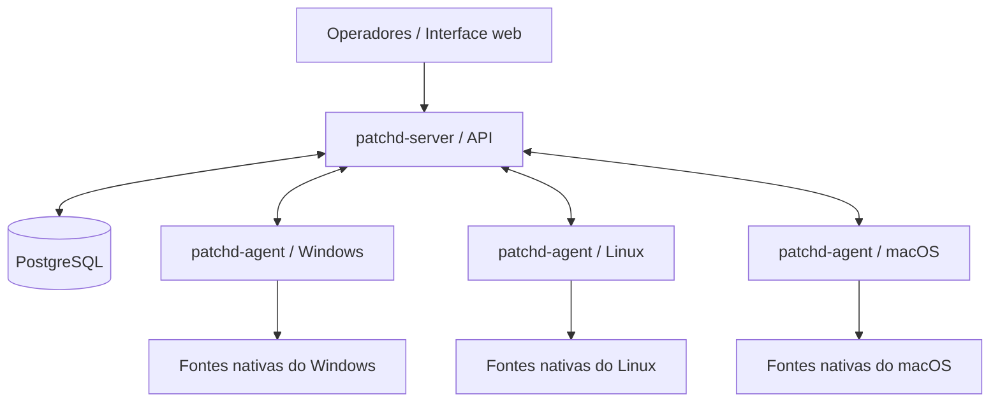

# patchd

**Inventário de ativos, gestão de atualizações e conformidade de endpoints.**

O **patchd** é um projeto de gerenciamento centralizado de estações e servidores, desenvolvido principalmente em **Go**, com arquitetura composta por um agente instalado nos dispositivos e um servidor responsável por receber informações, aplicar políticas e coordenar operações autorizadas.

O objetivo é oferecer uma base para compreender **quais equipamentos existem, o que está instalado, quais atualizações estão pendentes e quais ações tiveram seu resultado efetivamente comprovado** em ambientes Windows, Linux e macOS.

> **Estado do projeto:** em desenvolvimento. A presença de uma funcionalidade nos requisitos ou na Wiki não significa, por si só, que ela esteja implementada ou pronta para produção. Consulte a versão do código, os testes e a documentação operacional antes de utilizá-la.

**[Documentação (Wiki)](https://github.com/tasantiago/patchd/wiki)** · **[Trilha Júnior](https://github.com/tasantiago/patchd/wiki/Trilha-junior)** · **[Trilha Pleno](https://github.com/tasantiago/patchd/wiki/Trilha-pleno)** · **[Manual do Usuário](https://github.com/tasantiago/patchd/wiki/Manual-do-usuario)** · **[Como contribuir](https://github.com/tasantiago/patchd/wiki/Como-contribuir)**

---

## Por que o patchd existe?

Em uma rede com muitos dispositivos, uma estação pode aparecer como conectada e ainda assim estar com o inventário antigo; uma atualização pode ter sido executada sem que sua aplicação tenha sido confirmada; e duas fontes de dados podem apresentar informações diferentes sobre o mesmo software.

O patchd procura tratar essas situações de forma verificável, separando:

- **Identificação e comunicação:** o dispositivo está registrado e consegue conversar com o servidor?
- **Inventário:** quais informações foram coletadas, de que fonte e em qual momento?
- **Atualizações:** quais correções estão disponíveis, instaladas ou ainda exigem verificação?
- **Conformidade:** o estado observado atende à política definida?
- **Operações remotas:** uma tarefa foi autorizada, executada e teve seu efeito confirmado?

A distinção entre **dado inexistente**, **dado desatualizado** e **estado conforme** é central para evitar conclusões incorretas.

## Visão geral da arquitetura



*Diagrama conceitual: os protocolos, fluxos e componentes efetivamente habilitados dependem da versão do projeto.*

| Componente | Responsabilidade principal |
| --- | --- |
| `patchd-agent` | Identificar o endpoint, coletar dados e executar somente ações tipadas e autorizadas. |
| `patchd-server` | Receber e validar dados, persistir observações, avaliar políticas e coordenar tarefas e campanhas. |
| PostgreSQL | Armazenar informações necessárias à operação do servidor. |
| Interface web | Oferecer acesso às informações e operações disponíveis para cada perfil autorizado. |
| Fontes do sistema operacional | Fornecer evidências de software, sistema operacional e atualizações, conforme suporte da versão. |

**Princípio de arquitetura:** o agente coleta e executa; o servidor define as políticas e as autorizações.

Saiba mais em [Arquitetura](https://github.com/tasantiago/patchd/wiki/Arquitetura) e [Fluxos principais](https://github.com/tasantiago/patchd/wiki/Fluxos-principais).

## Áreas funcionais

As áreas abaixo representam o **escopo e a direção do projeto**, e não uma garantia de disponibilidade integral em todas as revisões.

| Área | O que se pretende gerenciar |
| --- | --- |
| Inventário | Dispositivos, sistema operacional, softwares, versões e evidências de coleta. |
| Atualizações | Consultas às fontes nativas e identificação de correções disponíveis ou instaladas. |
| Conformidade | Avaliação baseada em políticas, fonte dos dados e atualidade das observações. |
| Jobs | Solicitação, autorização, acompanhamento e verificação de tarefas específicas. |
| Campanhas | Planejamento de implantações controladas, por etapas ou anéis. |
| Segurança | Identidade dos agentes, autenticação, autorização e rastreabilidade de operações. |
| Autoatendimento | Catálogo e solicitações de software, quando suportados e habilitados. |

Para requisitos e limites detalhados, consulte [docs/requisitos.md](docs/requisitos.md), [docs/fontes-de-verdade.md](docs/fontes-de-verdade.md) e [docs/seguranca.md](docs/seguranca.md).

## Por onde começar

| Perfil | Caminho recomendado |
| --- | --- |
| **Usuário ou operador** | [Manual do Usuário](https://github.com/tasantiago/patchd/wiki/Manual-do-usuario) → [Utilização](https://github.com/tasantiago/patchd/wiki/Usuario-03-Utilizacao). |
| **Administrador** | [Instalação](https://github.com/tasantiago/patchd/wiki/Usuario-01-Instalacao) → [Configuração](https://github.com/tasantiago/patchd/wiki/Usuario-02-Configuracao) → [Diagnóstico](https://github.com/tasantiago/patchd/wiki/Usuario-05-Diagnostico). |
| **Desenvolvedor júnior** | [Trilha Júnior](https://github.com/tasantiago/patchd/wiki/Trilha-junior): funcionamento do sistema, agente, inventário, atualizações e diagnóstico. |
| **Desenvolvedor pleno** | [Trilha Pleno](https://github.com/tasantiago/patchd/wiki/Trilha-pleno): arquitetura, API, persistência, resiliência, jobs e integrações. |
| **Desenvolvedor de interface** | [Módulo de Edição de Layout](https://github.com/tasantiago/patchd/wiki/Modulo-edicao-de-layout). |
| **Colaborador** | [Como contribuir](https://github.com/tasantiago/patchd/wiki/Como-contribuir) e [Primeiras issues](https://github.com/tasantiago/patchd/wiki/Primeiras-issues). |

## Início rápido para desenvolvimento

> As instruções abaixo são destinadas a um **ambiente de desenvolvimento isolado**. Não são um procedimento de instalação em produção.

### 1. Pré-requisitos

- Git;
- Docker com Docker Compose, caso utilize o ambiente em contêiner;
- um terminal Linux ou WSL2 para os exemplos de shell;
- Go na versão declarada pelo `go.mod`, caso compile diretamente no host;
- editor de código de sua preferência.

### 2. Obter o código e identificar a revisão

```bash
git clone https://github.com/tasantiago/patchd.git
cd patchd

git rev-parse --short HEAD
cat go.mod | head -20
```

A versão do Go e as dependências devem ser consultadas no próprio `go.mod` da revisão utilizada.

### 3. Inspecionar o ambiente Docker

```bash
docker compose version
docker compose config --services
docker compose config --quiet
```

Confira os serviços disponíveis, as variáveis necessárias, os volumes montados e as portas **antes de iniciar contêineres**. No ambiente de desenvolvimento documentado na Wiki, o serviço é denominado `dev`; confirme que ele ainda existe na revisão em uso.

Se a configuração local estiver completa e o serviço `dev` estiver presente:

```bash
docker compose up -d --build dev
docker compose exec dev zsh
```

Dentro do contêiner, caso o projeto esteja montado no diretório de trabalho:

```bash
go version
go build ./cmd/...
go test ./...
go vet ./...
```

Alguns testes podem exigir banco de dados, serviços adicionais ou recursos específicos do sistema operacional. Uma compilação bem-sucedida em Linux não substitui a validação de componentes Windows e macOS.

Para encerrar o ambiente, saia do shell e execute `docker compose down` no host. **Evite `down -v` sem verificar os volumes e os dados que seriam removidos.**

Guia detalhado: [Ambiente de desenvolvimento](https://github.com/tasantiago/patchd/wiki/Ambiente-de-desenvolvimento).

## Instalação e operação

O ambiente de desenvolvimento **não equivale** à instalação operacional do servidor e dos agentes. Antes de implantar:

1. Escolha uma tag ou revisão aprovada.
2. Consulte [docs/operacao.md](docs/operacao.md) e os artefatos de implantação correspondentes à versão.
3. Planeje PostgreSQL, TLS, identidade, rede, armazenamento de segredos, backups e reversão.
4. Homologue o servidor e um agente de teste antes de envolver máquinas reais.
5. Verifique quais ações privilegiadas estão habilitadas e quem pode autorizá-las.

Consulte o [Manual de Instalação](https://github.com/tasantiago/patchd/wiki/Usuario-01-Instalacao) e o [Manual de Configuração](https://github.com/tasantiago/patchd/wiki/Usuario-02-Configuracao).

## Como contribuir

Contribuições em código, documentação, testes, interface e diagnóstico são bem-vindas.

1. Leia a [Visão geral](https://github.com/tasantiago/patchd/wiki/Visao-geral-do-projeto) e os [requisitos](docs/requisitos.md) relacionados ao que deseja melhorar.
2. Verifique as [Issues](https://github.com/tasantiago/patchd/issues) para evitar retrabalho e alinhar o escopo da mudança.
3. Crie uma branch com uma alteração pequena e explicável.
4. Inclua testes ou evidências apropriadas, além da atualização documental quando necessário.
5. Abra um Pull Request explicando motivação, comportamento esperado, validações, riscos e compatibilidade.

Exemplo de preparação de uma branch:

```bash
git switch main
git pull --ff-only origin main
git switch -c docs/melhoria-documentacao

# Depois de editar os arquivos desejados:
git diff --check
git status --short
```

Antes do PR, revise o conteúdo com atenção: nunca inclua dados de inventário reais, segredos, credenciais ou certificados privados.

Veja [Como contribuir](https://github.com/tasantiago/patchd/wiki/Como-contribuir), [Testes e qualidade](https://github.com/tasantiago/patchd/wiki/Testes-e-qualidade) e [Segurança no desenvolvimento](https://github.com/tasantiago/patchd/wiki/Seguranca-no-desenvolvimento).

## Princípios de segurança e confiabilidade

- Uma comunicação bem-sucedida com o agente **não comprova** que o inventário está atualizado.
- Um código de saída `0` **não comprova sozinho** que a atualização produziu o efeito desejado.
- Dados de fontes indisponíveis ou incompletas não devem ser tratados automaticamente como conformidade.
- Jobs devem ser limitados a operações previstas, com identidade, autorização e rastreabilidade; não ofereça execução arbitrária de shell.
- Mudanças que envolvam privilégios elevados, instalação de software, reboot ou firmware exigem análise e validação específicas.
- Evite registrar tokens, senhas, certificados privados e dados pessoais em código, logs, Issues ou Pull Requests.

Consulte [docs/seguranca.md](docs/seguranca.md) e [Segurança no desenvolvimento](https://github.com/tasantiago/patchd/wiki/Seguranca-no-desenvolvimento).

## Documentação de referência

| Recurso | Finalidade |
| --- | --- |
| [Wiki do patchd](https://github.com/tasantiago/patchd/wiki) | Portal central de documentação e formação. |
| [docs/requisitos.md](docs/requisitos.md) | Requisitos funcionais, não funcionais e restrições. |
| [docs/fontes-de-verdade.md](docs/fontes-de-verdade.md) | Fontes consideradas para inventário e atualizações em cada SO. |
| [docs/operacao.md](docs/operacao.md) | Orientações operacionais vinculadas ao código. |
| [docs/seguranca.md](docs/seguranca.md) | Modelo de ameaças e decisões de segurança. |
| [docs/pacotes-de-scripts.md](docs/pacotes-de-scripts.md) | Cadastro e execução de ZIPs e scripts avulsos, parâmetros, timeout e migração do ITOM. |
| [docs/rotas.md](docs/rotas.md) | Inventário de rotas, quando presente na revisão utilizada. |
| [Mapa do repositório](https://github.com/tasantiago/patchd/wiki/Mapa-do-repositorio) | Orientação para localizar entradas e implementações no código. |
| [Exemplos práticos](https://github.com/tasantiago/patchd/wiki/Exemplos-praticos) | Atividades comentadas nas trilhas e manuais. |

## Evolução do projeto

O patchd é um projeto em desenvolvimento contínuo. Para conhecer o estado de uma funcionalidade, considere em conjunto a **revisão do código**, os **testes**, as **Issues** e os **requisitos documentados**. Use a [Wiki de decisões e roadmap](https://github.com/tasantiago/patchd/wiki/Decisoes-e-roadmap) como referência complementar, não como prova de entrega.

---

**Quer ajudar a desenvolver o patchd?** Comece pela [Trilha Júnior](https://github.com/tasantiago/patchd/wiki/Trilha-junior) ou pela [Trilha Pleno](https://github.com/tasantiago/patchd/wiki/Trilha-pleno) e escolha uma contribuição de escopo verificável.
