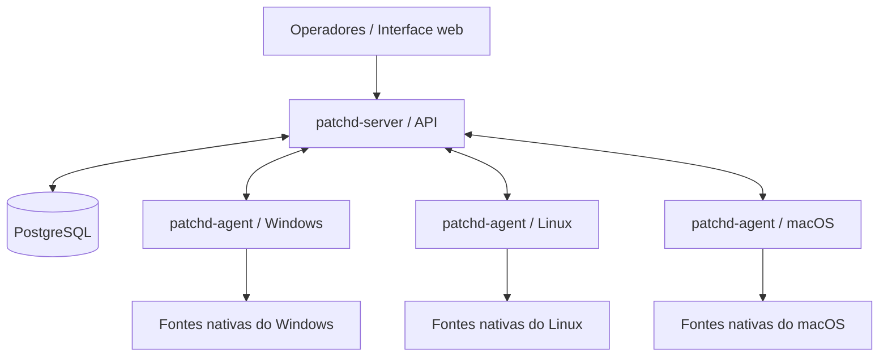

# patchd

**Inventário de ativos, gestão de atualizações e conformidade de endpoints.**

O **patchd** é um projeto de gerenciamento centralizado de estações e servidores, desenvolvido principalmente em **Go**, com arquitetura composta por um agente instalado nos dispositivos e um servidor responsável por receber informações, aplicar políticas e coordenar operações autorizadas.

O objetivo é oferecer uma base para compreender **quais equipamentos existem, o que está instalado, quais atualizações estão pendentes e quais ações tiveram seu resultado efetivamente comprovado** em ambientes Windows, Linux e macOS.

> **Estado do projeto:** em desenvolvimento. A presença de uma funcionalidade nos requisitos ou na Wiki não significa, por si só, que ela esteja implementada ou pronta para produção. Consulte a versão do código, os testes e a documentação operacional antes de utilizá-la.

**[Instalar servidor do zero](#instalar-um-servidor-novo-do-zero)** · **[Documentação (Wiki)](https://github.com/tasantiago/patchd/wiki)** · **[Trilha Júnior](https://github.com/tasantiago/patchd/wiki/Trilha-junior)** · **[Trilha Pleno](https://github.com/tasantiago/patchd/wiki/Trilha-pleno)** · **[Manual do Usuário](https://github.com/tasantiago/patchd/wiki/Manual-do-usuario)** · **[Como contribuir](https://github.com/tasantiago/patchd/wiki/Como-contribuir)**

---

## Por que o patchd existe?

Em uma rede com muitos dispositivos, uma estação pode aparecer como conectada e ainda assim estar com o inventário antigo; uma atualização pode ter sido executada sem que sua aplicação tenha sido confirmada; e duas fontes de dados podem apresentar informações diferentes sobre o mesmo software.

O patchd procura tratar essas situações de forma verificável, separando:

- **Identificação e comunicação:** o dispositivo está registrado e consegue conversar com o servidor?
- **Inventário:** quais informações foram coletadas, de que fonte e em qual momento?
- **Atualizações:** quais correções estão disponíveis, instaladas ou ainda exigem verificação?
- **Conformidade:** o estado observado atende à política definida?
- **Operações remotas:** uma tarefa foi autorizada, executada e teve seu efeito confirmado?

A distinção entre **dado inexistente**, **dado desatualizado** e **estado conforme** é central para evitar conclusões incorretas.

## Visão geral da arquitetura



*Diagrama conceitual: os protocolos, fluxos e componentes efetivamente habilitados dependem da versão do projeto.*

| Componente | Responsabilidade principal |
| --- | --- |
| `patchd-agent` | Identificar o endpoint, coletar dados e executar somente ações tipadas e autorizadas. |
| `patchd-server` | Receber e validar dados, persistir observações, avaliar políticas e coordenar tarefas e campanhas. |
| PostgreSQL | Armazenar informações necessárias à operação do servidor. |
| Interface web | Oferecer acesso às informações e operações disponíveis para cada perfil autorizado. |
| Fontes do sistema operacional | Fornecer evidências de software, sistema operacional e atualizações, conforme suporte da versão. |

**Princípio de arquitetura:** o agente coleta e executa; o servidor define as políticas e as autorizações.

Saiba mais em [Arquitetura](https://github.com/tasantiago/patchd/wiki/Arquitetura) e [Fluxos principais](https://github.com/tasantiago/patchd/wiki/Fluxos-principais).

## Áreas funcionais

As áreas abaixo representam o **escopo e a direção do projeto**, e não uma garantia de disponibilidade integral em todas as revisões.

| Área | O que se pretende gerenciar |
| --- | --- |
| Inventário | Dispositivos, sistema operacional, softwares, versões e evidências de coleta. |
| Atualizações | Consultas às fontes nativas e identificação de correções disponíveis ou instaladas. |
| Conformidade | Avaliação baseada em políticas, fonte dos dados e atualidade das observações. |
| Jobs | Solicitação, autorização, acompanhamento e verificação de tarefas específicas. |
| Campanhas | Planejamento de implantações controladas, por etapas ou anéis. |
| Segurança | Identidade dos agentes, autenticação, autorização e rastreabilidade de operações. |
| Autoatendimento | Catálogo e solicitações de software, quando suportados e habilitados. |

Para requisitos e limites detalhados, consulte [docs/requisitos.md](docs/requisitos.md), [docs/fontes-de-verdade.md](docs/fontes-de-verdade.md) e [docs/seguranca.md](docs/seguranca.md).

## Por onde começar

| Perfil | Caminho recomendado |
| --- | --- |
| **Usuário ou operador** | [Manual do Usuário](https://github.com/tasantiago/patchd/wiki/Manual-do-usuario) → [Utilização](https://github.com/tasantiago/patchd/wiki/Usuario-03-Utilizacao). |
| **Administrador** | [Servidor novo do zero](#instalar-um-servidor-novo-do-zero) → [Instalação](https://github.com/tasantiago/patchd/wiki/Usuario-01-Instalacao) → [Configuração](https://github.com/tasantiago/patchd/wiki/Usuario-02-Configuracao) → [Diagnóstico](https://github.com/tasantiago/patchd/wiki/Usuario-05-Diagnostico). |
| **Desenvolvedor júnior** | [Trilha Júnior](https://github.com/tasantiago/patchd/wiki/Trilha-junior): funcionamento do sistema, agente, inventário, atualizações e diagnóstico. |
| **Desenvolvedor pleno** | [Trilha Pleno](https://github.com/tasantiago/patchd/wiki/Trilha-pleno): arquitetura, API, persistência, resiliência, jobs e integrações. |
| **Desenvolvedor de interface** | [Módulo de Edição de Layout](https://github.com/tasantiago/patchd/wiki/Modulo-edicao-de-layout). |
| **Colaborador** | [Como contribuir](https://github.com/tasantiago/patchd/wiki/Como-contribuir) e [Primeiras issues](https://github.com/tasantiago/patchd/wiki/Primeiras-issues). |

## Instalar um servidor novo do zero

O caminho abaixo usa uma **VM Ubuntu 24.04 LTS de 64 bits (amd64 ou arm64) com Docker Engine e Compose V2**. A imagem de produção compila o servidor diretamente do repositório com o Go declarado em [deploy/Dockerfile](deploy/Dockerfile). O host não precisa ter Go instalado.

Você vai obter o código, criar a configuração e as chaves desta instalação, preparar TLS, subir o PostgreSQL e o servidor e criar o primeiro administrador. **Nenhum binário, volume, certificado ou segredo precisa ser extraído do contêiner `dev`.**

Para **RHEL 10 com Podman sem root e Quadlet**, siga [o roteiro de Podman](docs/podman.md). Ele usa o mesmo Dockerfile de produção; as permissões e os comandos de serviço são diferentes dos apresentados aqui.

### 1. Preparar a VM

Tenha um nome DNS para o servidor, acesso administrativo à VM e saída HTTPS para GitHub, registro de imagens e módulos Go. Reserve espaço para imagens de build, banco, conteúdo dos pacotes e backups; o primeiro build precisa de vários GB livres. A instalação precisa de um certificado TLS para o nome DNS escolhido.

No Ubuntu novo, abra um terminal administrativo e instale as ferramentas:

```bash
sudo -i
apt-get update
apt-get install -y git ca-certificates curl openssl acl
```

Instale o Docker pelo [repositório oficial para Ubuntu](https://docs.docker.com/engine/install/ubuntu/). Na VM nova, sem outra instalação de Docker/containerd:

```bash
install -m 0755 -d /etc/apt/keyrings
curl -fsSL https://download.docker.com/linux/ubuntu/gpg -o /etc/apt/keyrings/docker.asc
chmod a+r /etc/apt/keyrings/docker.asc

cat > /etc/apt/sources.list.d/docker.sources <<EOF
Types: deb
URIs: https://download.docker.com/linux/ubuntu
Suites: $(. /etc/os-release && echo "${UBUNTU_CODENAME:-$VERSION_CODENAME}")
Components: stable
Architectures: $(dpkg --print-architecture)
Signed-By: /etc/apt/keyrings/docker.asc
EOF

apt-get update
apt-get install -y docker-ce docker-ce-cli containerd.io docker-buildx-plugin docker-compose-plugin
systemctl enable --now docker
docker run --rm hello-world
docker compose version
```

Continue no mesmo terminal administrativo. O roteiro usa Docker convencional, com daemon rootful; para operação sem root, use o guia de Podman. Se já houver Docker ou containerd no host, confira os conflitos de pacotes na documentação oficial antes de instalar.

### 2. Clonar o projeto e definir os dados da instalação

```bash
git clone https://github.com/tasantiago/patchd.git /opt/patchd
cd /opt/patchd
git rev-parse HEAD

# Substitua pelo nome DNS real, apontando para esta VM.
PATCHD_FQDN='patchd.exemplo.invalid'

# Rótulo local da imagem, não uma tag de release publicada no GitHub.
PATCHD_INSTALACAO_VERSION='v0.0.0-instalacao.1'
```

O domínio `.invalid` é ilustrativo: substitua-o antes de continuar e confira a resolução com `getent hosts "$PATCHD_FQDN"`. Para uma implantação aprovada, selecione a tag ou o commit definido pela equipe e registre o hash antes do build. O rótulo passado ao build não faz checkout de uma versão.

Crie a configuração de produção a partir do modelo versionado:

```bash
cp deploy/.env.exemplo deploy/.env
chmod 600 deploy/.env
sed -i "s|^PATCHD_PUBLIC_URL=.*|PATCHD_PUBLIC_URL=https://${PATCHD_FQDN}:8443|" deploy/.env
sed -i 's/^PATCHD_HTTP_BIND=.*/PATCHD_HTTP_BIND=127.0.0.1/' deploy/.env
cat >> deploy/.env <<'ENV'
PATCHD_HTTP_LISTEN_ADDR=
PATCHD_AGENT_CA_FILE=/run/patchd/tls/ca.crt
ENV

umask 077
mkdir -p deploy/secrets deploy/tls releases
chmod 700 deploy/secrets deploy/tls releases
```

Esse início usa login local. AD/LDAP, OIDC/Keycloak, SMTP, descoberta e guarda de BIOS são integrações opcionais; os campos correspondentes podem continuar vazios. O Compose da raiz (`docker-compose.yml`) é de desenvolvimento; para este servidor, use os arquivos de `deploy/` e o wrapper `./deploy/compose.sh`.

### 3. Compilar a imagem de produção

```bash
docker build -f deploy/Dockerfile \
  --build-arg VERSION="$PATCHD_INSTALACAO_VERSION" \
  --build-arg COMMIT="$(git rev-parse HEAD)" \
  -t "patchd-server:$PATCHD_INSTALACAO_VERSION" .

docker run --rm --network none "patchd-server:$PATCHD_INSTALACAO_VERSION" -version
```

O build baixa a imagem oficial do Go e os módulos e produz uma imagem final com o binário, os certificados públicos de confiança e as pastas de dados. Os segredos locais ficam fora do contexto de build pelo `.dockerignore`.

Se a rede usa inspeção TLS, obtenha o certificado **público** da CA com a equipe de infraestrutura e coloque-o em `.docker/certs/` como PEM com extensão `.crt` antes do build. Configure também a confiança e o proxy do host/Docker conforme a rede. A origem desse certificado é a PKI da organização; não é necessário copiá-lo de um ambiente de desenvolvimento.

### 4. Gerar a chave de jobs desta instalação

Para uma **frota nova**, gere o par usando a imagem recém-compilada:

```bash
docker run --rm --network none --user "$(id -u):$(id -g)" \
  --mount "type=bind,src=$PWD/deploy/secrets,dst=/segredos" \
  "patchd-server:$PATCHD_INSTALACAO_VERSION" \
  job keygen -out /segredos/job_signing_key \
  > deploy/secrets/job_signing_key.pub
```

A privada fica em `deploy/secrets/job_signing_key`; a pública, em `job_signing_key.pub`, será usada no build dos agentes. A geração recusa sobrescrever uma privada existente. Guarde uma cópia protegida da privada fora desta VM.

Se estiver **migrando uma frota existente**, preserve a chave de jobs de produção e os dados dessa implantação: gerar outra chave faz os agentes antigos recusarem os jobs. Isso é uma migração, diferente de criar uma instalação independente.

### 5. Preparar TLS

Gere uma chave e uma solicitação de certificado novas nesta VM:

```bash
openssl req -new -newkey rsa:3072 -nodes \
  -keyout deploy/tls/server.key \
  -out deploy/tls/server.csr \
  -subj "/CN=${PATCHD_FQDN}" \
  -addext "subjectAltName=DNS:${PATCHD_FQDN}"
```

Entregue somente o `server.csr` à CA da organização. Prepare os arquivos:

| Arquivo | Conteúdo |
| --- | --- |
| `deploy/tls/server.key` | A chave privada gerada acima, sem senha interativa, protegida por permissões. |
| `deploy/tls/server.crt` | Certificado emitido para esse DNS, seguido das intermediárias necessárias, em PEM. |
| `deploy/tls/ca.crt` | Certificado ou conjunto de certificados públicos da CA para confiar nessa cadeia. |

Para montar um **laboratório isolado sem uma CA existente**, siga [TLS de laboratório](docs/tls-laboratorio.md) depois de gerar o CSR. O exemplo cria uma CA nova fora do repositório e assina esse CSR; não usa arquivos do contêiner de desenvolvimento.

O nome em `PATCHD_PUBLIC_URL` precisa constar no SAN do certificado. Navegadores e agentes devem confiar na CA; distribua apenas o certificado público da CA pelos meios da organização. A privada da CA não pertence ao servidor da aplicação.

### 6. Preparar os demais segredos e as permissões

Com a chave de jobs, o `.env` e o TLS presentes:

```bash
./deploy/gerar-segredos.sh

# O servidor da imagem roda como UID 65532. Segredos do Compose preservam
# as permissões dos arquivos do host; o diretório TLS também precisa ser legível.
for arquivo in database_url job_signing_key bios_escrow_key oidc_client_secret metrics_token smtp_password; do
  setfacl -m u:65532:r "deploy/secrets/$arquivo"
done
setfacl -m u:65532:rx deploy/tls releases
setfacl -m u:65532:r deploy/tls/server.key deploy/tls/server.crt deploy/tls/ca.crt

./deploy/compose.sh config --quiet
./deploy/compose.sh config --services
```

O script gera a senha e a URL do PostgreSQL, o token de métricas e os arquivos vazios das integrações opcionais. Ele não substitui segredos existentes. A senha do PostgreSQL é usada na criação inicial do volume; trocar apenas o arquivo depois não altera a senha de um banco já inicializado.

O resultado de `config --services` deve listar `postgres` e `server`. Use `config --quiet` para validar sem imprimir a configuração inteira. Nos comandos operacionais, o wrapper evita que variáveis `PATCHD_*` exportadas no terminal substituam o `deploy/.env`.

### 7. Subir o PostgreSQL e o servidor

```bash
./deploy/atualizar.sh "$PATCHD_INSTALACAO_VERSION"
./deploy/compose.sh ps
./deploy/compose.sh logs --tail 50 server
```

O mesmo script atende à primeira instalação: sobe o banco, constrói a imagem do commit atual, identifica que o banco está vazio, registra a versão, sobe o servidor e espera o healthcheck. A construção inicial do passo 3 permite gerar a chave antes desse fluxo; o build seguinte reaproveita o cache.

As migrations são incorporadas ao binário e aplicadas automaticamente antes de abrir a API. O PostgreSQL usa a imagem e o caminho de volume definidos em `deploy/compose.yaml`; não é necessário instalar PostgreSQL nem executar SQL manualmente no host.

Confira HTTPS a partir da VM e depois de uma máquina cliente autorizada:

```bash
curl --fail --show-error --cacert deploy/tls/ca.crt \
  "https://${PATCHD_FQDN}:8443/healthz"
```

Espere HTTP 200 e os dois serviços saudáveis. Libere o acesso à porta HTTPS nas regras de rede da implantação. Considere as [regras de firewall e portas publicadas pelo Docker](https://docs.docker.com/engine/install/ubuntu/#firewall-limitations), inclusive ao usar UFW.

| Porta | Uso neste roteiro |
| --- | --- |
| TCP 8443 | HTTPS para painel, API e agentes; limitar às redes autorizadas. |
| TCP 5432 | Banco na rede interna do Compose, sem publicação no host. |
| TCP 9090 | Métricas com token, publicadas somente em `127.0.0.1` por padrão. |
| TCP 8080 | Listener HTTP desativado neste roteiro; o mapeamento do Compose fica limitado a `127.0.0.1`. |

### 8. Criar o primeiro administrador e entrar

Não há usuário ou senha padrão. Crie uma conta local, passando a senha pela entrada padrão:

```bash
read -r -s -p 'Senha do administrador (mínimo de 12 caracteres): ' PATCHD_ADMIN_PASSWORD
printf '\n'
printf '%s\n' "$PATCHD_ADMIN_PASSWORD" | \
  ./deploy/compose.sh exec -T server /patchd-server user create -name admin -role admin
unset PATCHD_ADMIN_PASSWORD

./deploy/compose.sh exec -T server /patchd-server user list
```

Abra **`https://SEU_FQDN:8443/painel/entrar`** no navegador que confia na CA e use a conta criada. A senha não deve ser colocada como argumento, gravada no `.env` ou enviada a um repositório.

### 9. Preparar agentes e validar o primeiro equipamento

O servidor já pode operar com banco, HTTPS e login local. Para receber equipamentos, prepare agentes dessa instalação:

| Material | Onde é criado e utilizado |
| --- | --- |
| Chave privada de jobs | Gerada no passo 4; permanece protegida no servidor e assina jobs. |
| Chave pública de jobs | `deploy/secrets/job_signing_key.pub`; embutida no agente como `PATCHD_JOB_PUBKEY`. |
| Chave de assinatura de releases | Gerada na estação de build/administração; a privada fica fora do servidor. A pública é `PATCHD_UPDATE_PUBKEY` no build dos agentes. |
| CA pública do servidor | `deploy/tls/ca.crt`; distribuída aos clientes, conforme o método de instalação. |
| Token de enrollment | Criado no servidor para registrar agentes, com prazo e quantidade de usos definidos. |

Chaves de jobs, assinatura de releases e TLS têm funções diferentes. Um agente compilado com outra pública de jobs não executará as tarefas deste servidor. O código e as ferramentas de build vêm do Git; não reutilize um executável desconhecido extraído de um contêiner.

Para conferir a pública no servidor e criar um token de piloto com um uso e validade de duas horas:

```bash
./deploy/compose.sh exec -T server /patchd-server job pubkey
./deploy/compose.sh exec -T server /patchd-server token create -uses 1 -ttl 2h -note 'piloto inicial'
```

O token é exibido uma única vez: guarde-o pelo meio autorizado, sem publicar a saída. Para build e publicação de agentes, consulte [operação e rotação de chaves](docs/operacao.md); no RHEL/Podman, [deploy/agente.sh](deploy/agente.sh) usa uma imagem oficial de Go no próprio host. No Docker, as ferramentas também podem ser executadas em um contêiner oficial de Go, conforme [build de agentes sem o dev](docs/build-agentes-sem-dev.md).

Instale um agente em uma máquina de homologação usando a URL HTTPS, a CA e o token. Confira registro, primeiro check-in e inventário antes de ampliar a frota. Para automação com pacotes ZIP ou scripts avulsos, use [o guia de pacotes de scripts](docs/pacotes-de-scripts.md).

### 10. Fechar a instalação com backup e recuperação

```bash
./deploy/backup.sh
```

Configure a agenda e ensaie a restauração conforme [docs/operacao.md](docs/operacao.md). Preserve fora desta VM as cópias do banco, a configuração, as chaves e o conteúdo necessário à recuperação.

| Dados | Persistência |
| --- | --- |
| Banco | Volume `pgdata` do Compose. |
| Pacotes e conteúdo | Volume `conteudo`; inclui os ZIPs usados pelos jobs de scripts. |
| Cache de repositórios | Volume `repocache`. |
| Releases de agentes | Diretório `releases/` no host, montado somente para leitura no servidor. |
| Configuração e segredos | `deploy/.env`, `deploy/secrets/` e `deploy/tls/`, fora do Git. |

O backup lógico do banco não contém os arquivos dos volumes e diretórios acima. Não use `down -v` para manutenção rotineira: isso remove os volumes. Excluir um cadastro de script também não é uma política de limpeza dos arquivos usados por jobs emitidos.

### Problemas na primeira subida

| Sintoma | Conferir |
| --- | --- |
| Build falha com CA desconhecida | Confiança do host/daemon, proxy e CA pública em `.docker/certs/`; refazer o build após corrigir. |
| Arquivo de segredo ou TLS ausente | Passos 4 a 6, nomes de arquivo e execução de `gerar-segredos.sh`. |
| `permission denied` em TLS/segredo | ACL dos arquivos e permissão de travessia da pasta TLS para o UID 65532. |
| Banco não fica saudável | `./deploy/compose.sh logs --tail 50 postgres`, disco e estado do volume. |
| Servidor não fica saudável | `./deploy/compose.sh logs --tail 50 server`; conexão com banco, TLS e migrations. |
| HTTPS falha no cliente | DNS, SAN, cadeia emitida e confiança na CA; testar sem desabilitar TLS. |
| Login negado | Primeiro administrador criado, senha e URL HTTPS corretas. |
| Painel não oferece agente para baixar | Build, assinatura e publicação de uma release ainda precisam ser feitos. |
| Agente recusa jobs | Pública embutida no build precisa corresponder à privada desta instalação. |

## Desenvolvimento local

O ambiente de desenvolvimento é opcional e separado da instalação descrita acima. Para contribuir com o código, consulte [CONTRIBUTING.md](CONTRIBUTING.md) e [o ambiente de desenvolvimento](https://github.com/tasantiago/patchd/wiki/Ambiente-de-desenvolvimento). Com Go na versão do `go.mod`, as verificações usuais são:

```bash
go build ./cmd/...
go test ./...
go vet ./...
```

## Como contribuir

Contribuições em código, documentação, testes, interface e diagnóstico são bem-vindas.

1. Leia a [Visão geral](https://github.com/tasantiago/patchd/wiki/Visao-geral-do-projeto) e os [requisitos](docs/requisitos.md) relacionados ao que deseja melhorar.
2. Verifique as [Issues](https://github.com/tasantiago/patchd/issues) para evitar retrabalho e alinhar o escopo da mudança.
3. Crie uma branch com uma alteração pequena e explicável.
4. Inclua testes ou evidências apropriadas, além da atualização documental quando necessário.
5. Abra um Pull Request explicando motivação, comportamento esperado, validações, riscos e compatibilidade.

Exemplo de preparação de uma branch:

```bash
git switch main
git pull --ff-only origin main
git switch -c docs/melhoria-documentacao

# Depois de editar os arquivos desejados:
git diff --check
git status --short
```

Antes do PR, revise o conteúdo com atenção: nunca inclua dados de inventário reais, segredos, credenciais ou certificados privados.

Veja [Como contribuir](https://github.com/tasantiago/patchd/wiki/Como-contribuir), [Testes e qualidade](https://github.com/tasantiago/patchd/wiki/Testes-e-qualidade) e [Segurança no desenvolvimento](https://github.com/tasantiago/patchd/wiki/Seguranca-no-desenvolvimento).

## Princípios de segurança e confiabilidade

- Uma comunicação bem-sucedida com o agente **não comprova** que o inventário está atualizado.
- Um código de saída `0` **não comprova sozinho** que a atualização produziu o efeito desejado.
- Dados de fontes indisponíveis ou incompletas não devem ser tratados automaticamente como conformidade.
- Jobs devem ser limitados a operações previstas, com identidade, autorização e rastreabilidade; não ofereça execução arbitrária de shell.
- Mudanças que envolvam privilégios elevados, instalação de software, reboot ou firmware exigem análise e validação específicas.
- Evite registrar tokens, senhas, certificados privados e dados pessoais em código, logs, Issues ou Pull Requests.

Consulte [docs/seguranca.md](docs/seguranca.md) e [Segurança no desenvolvimento](https://github.com/tasantiago/patchd/wiki/Seguranca-no-desenvolvimento).

## Documentação de referência

| Recurso | Finalidade |
| --- | --- |
| [Wiki do patchd](https://github.com/tasantiago/patchd/wiki) | Portal central de documentação e formação. |
| [docs/requisitos.md](docs/requisitos.md) | Requisitos funcionais, não funcionais e restrições. |
| [docs/fontes-de-verdade.md](docs/fontes-de-verdade.md) | Fontes consideradas para inventário e atualizações em cada SO. |
| [docs/operacao.md](docs/operacao.md) | Orientações operacionais vinculadas ao código. |
| [docs/seguranca.md](docs/seguranca.md) | Modelo de ameaças e decisões de segurança. |
| [docs/tls-laboratorio.md](docs/tls-laboratorio.md) | TLS com CA nova para laboratório isolado. |
| [docs/build-agentes-sem-dev.md](docs/build-agentes-sem-dev.md) | Build, assinatura e publicação de agentes com imagem oficial de Go. |
| [docs/pacotes-de-scripts.md](docs/pacotes-de-scripts.md) | Cadastro e execução de ZIPs e scripts avulsos, parâmetros, timeout e migração do ITOM. |
| [docs/rotas.md](docs/rotas.md) | Inventário de rotas, quando presente na revisão utilizada. |
| [Mapa do repositório](https://github.com/tasantiago/patchd/wiki/Mapa-do-repositorio) | Orientação para localizar entradas e implementações no código. |
| [Exemplos práticos](https://github.com/tasantiago/patchd/wiki/Exemplos-praticos) | Atividades comentadas nas trilhas e manuais. |

## Evolução do projeto

O patchd é um projeto em desenvolvimento contínuo. Para conhecer o estado de uma funcionalidade, considere em conjunto a **revisão do código**, os **testes**, as **Issues** e os **requisitos documentados**. Use a [Wiki de decisões e roadmap](https://github.com/tasantiago/patchd/wiki/Decisoes-e-roadmap) como referência complementar, não como prova de entrega.

---

**Quer ajudar a desenvolver o patchd?** Comece pela [Trilha Júnior](https://github.com/tasantiago/patchd/wiki/Trilha-junior) ou pela [Trilha Pleno](https://github.com/tasantiago/patchd/wiki/Trilha-pleno) e escolha uma contribuição de escopo verificável.
